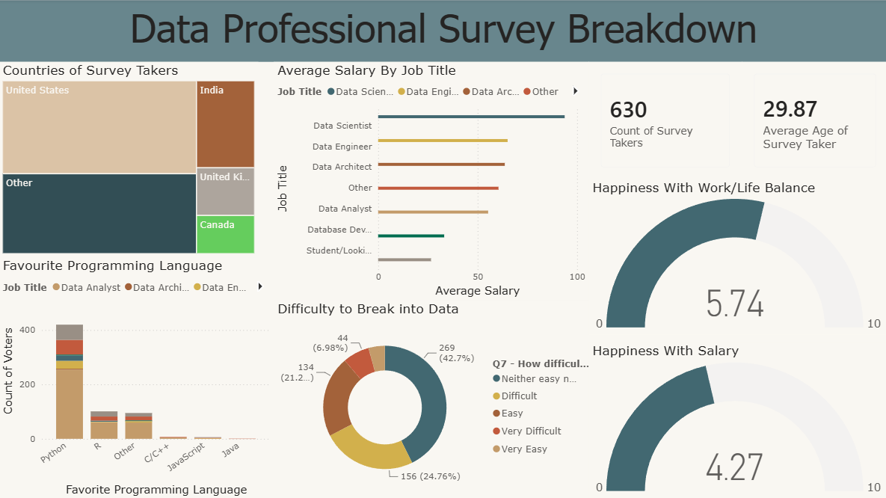

# Data Professional Survey Dashboard (Power BI)

## Objective
Analyse a survey of data professionals to understand salaries, preferred programming languages, job satisfaction and how difficult people find it to break into the data field.

## Dataset
Data Professional Survey dataset, a real survey of data professionals, provided by Alex the Analyst as part of his data analytics course.

## Approach
This was my first Power BI project, built while following the course walkthrough.
1. Loaded the survey data into Power BI
2. Built KPI cards for the number of survey takers and the average age
3. Created visuals for country, salary by job title, programming language, difficulty of breaking into data, and happiness scores
4. Chose my own colour theme and layout for the dashboard
5. Later fixed truncated labels on the cards to improve readability

## Dashboard preview

## Key findings
- The survey has 630 respondents with an average age of 29.87.
- Most respondents are from the United States, followed by India.
- Python is the most popular programming language by a wide margin.
- Data Scientists have the highest average salary among the job titles, ahead of Data Engineers and Data Architects.
- Happiness with work/life balance averages 5.74 out of 10, while happiness with salary is lower at 4.27 out of 10.
- About 43% of respondents say breaking into data is neither easy nor difficult, and about 25% say it is difficult.

## Tools
Power BI

## Files
- `Data_Professional_Survey_Breakdown`: Power BI report
- `Data_Professional_Survey_Dataset`: dataset
- `dashboard_preview.png`: dashboard screenshot
